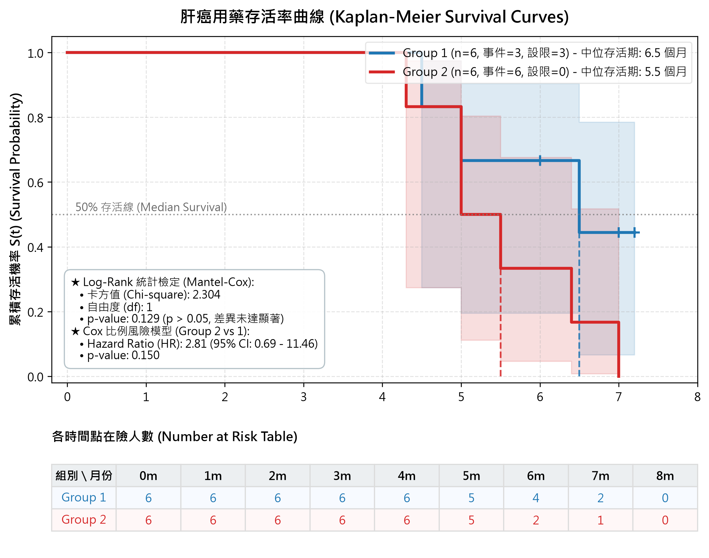

# 肝癌用藥存活分析 (Kaplan-Meier Survival Analysis for Liver Cancer Medication)

本專案為肝癌用藥試驗之存活分析（Survival Analysis）研究，包含 **Kaplan-Meier 乘積極限法存活曲線繪製**、**壽命表 (Life Table) 估計**、**Log-Rank 假設檢定（Mantel-Cox）** 與 **Cox 比例風險迴歸模型 (Hazard Ratio)**。

---

## 📊 研究成果與存活曲線 (Kaplan-Meier Survival Curves)



---

## 📈 核心統計結果摘要 (Summary of Statistical Findings)

| 分析指標 (Metric) | Group 1 | Group 2 | 整體 / 檢定結果 |
| :--- | :---: | :---: | :---: |
| **受試者人數 (Total N)** | 6 人 | 6 人 | 12 人 |
| **死亡事件數 (Events, d)** | 3 人 (50.0%) | 6 人 (100.0%) | 9 人 (75.0%) |
| **設限人數 (Censored, c)** | 3 人 (50.0%) | 0 人 (0.0%) | 3 人 (25.0%) |
| **平均追蹤時間 (Mean ± SD)** | 6.03 ± 1.13 個月 | 5.53 ± 0.99 個月 | 5.78 ± 1.05 個月 |
| **追蹤時間範圍 (Min ~ Max)** | 4.5 ~ 7.2 個月 | 4.3 ~ 7.0 個月 | 4.3 ~ 7.2 個月 |
| **中位存活時間 (Median Survival)** | **6.5 個月** | **5.5 個月** | Group 1 中位存活期較長 |
| **Log-Rank 檢定 (Mantel-Cox)** | $O_1 = 3, E_1 = 5.134$ | $O_2 = 6, E_2 = 3.866$ | **$\chi^2 = 2.304$, $df = 1$, $p = 0.1291$ (未達顯著)** |
| **Cox 模型風險比 (Group 2 vs 1)** | 1.00 (基準對照) | $\text{HR} = 2.81$ | 95% CI: $0.69 \sim 11.46$, $p = 0.1499$ |

---

## 🧮 Log-Rank 檢定逐步計算表 (Step-by-step Log-Rank Table)

在每個死亡事件發生時間點 $t_i$ 依據超幾何分佈計算期望死亡數與變異數：

| 事件時間 $t$ (月) | $n_{1i}$ | $O_{1i}$ | $E_{1i}$ | $n_{2i}$ | $O_{2i}$ | $E_{2i}$ | 合計在險 $n_i$ | 合計事件 $d_i$ | 超幾何變異數 $\text{Var}_i$ |
| :---: | :---: | :---: | :---: | :---: | :---: | :---: | :---: | :---: | :---: |
| **4.3** | 6 | 0 | 0.5000 | 6 | 1 | 0.5000 | 12 | 1 | 0.2500 |
| **4.5** | 6 | 1 | 0.5455 | 5 | 0 | 0.4545 | 11 | 1 | 0.2479 |
| **5.0** | 5 | 1 | 1.5000 | 5 | 2 | 1.5000 | 10 | 3 | 0.5833 |
| **5.5** | 4 | 0 | 0.5714 | 3 | 1 | 0.4286 | 7 | 1 | 0.2449 |
| **6.4** | 3 | 0 | 0.6000 | 2 | 1 | 0.4000 | 5 | 1 | 0.2400 |
| **6.5** | 3 | 1 | 0.7500 | 1 | 0 | 0.2500 | 4 | 1 | 0.1875 |
| **7.0** | 2 | 0 | 0.6667 | 1 | 1 | 0.3333 | 3 | 1 | 0.2222 |
| **總計 ($\sum$)** | - | **$O_1 = 3$** | **$E_1 = 5.1336$** | - | **$O_2 = 6$** | **$E_2 = 3.8664$** | - | **9** | **$\sum \text{Var} = 1.9758$** |

### 卡方統計量計算式：
$$\chi^2 = \frac{(O_1 - E_1)^2}{\sum \text{Var}_i} = \frac{(3 - 5.1336)^2}{1.9758} = \frac{4.5520}{1.9758} = 2.3040$$
$$\text{Degrees of freedom } (df) = 1, \quad p\text{-value} = 0.1291$$

> **推論結論**：在顯著水準 $\alpha = 0.05$ 下，$p = 0.1291 > 0.05$，未達統計上顯著差異。

---

## 📁 檔案結構 (File Structure)

- **`Survival test example.xlsx`**：原始試驗資料集（12 筆受試者資料）。
- **`肝癌用藥存活分析報告_Survival_Analysis_Report.docx`** / **`Survival_Analysis_Report.docx`**：正式排版之 Word 分析報告（含圖表與完整文字解說）。
- **`Survival_Analysis_Report.xlsx`**：多工作表 Excel 統計計算報表。
- **`km_survival_curve.png`**：300 DPI 出版級 Kaplan-Meier 存活曲線圖（含在險人數表）。
- **`survival_analysis.py`**：核心統計分析腳本（執行 KM 估計、Log-Rank 檢定、Cox 模型與製圖）。
- **`export_to_word.py`**：自動產生專業 Word 報告腳本。

---

## 🚀 執行方式 (How to Run)

```bash
# 1. 安裝必要套件
pip install pandas numpy matplotlib lifelines python-docx openpyxl

# 2. 執行存活分析並產出統計圖表與 Excel 報表
python survival_analysis.py

# 3. 匯出專業 Word 報告 (.docx)
python export_to_word.py
```
